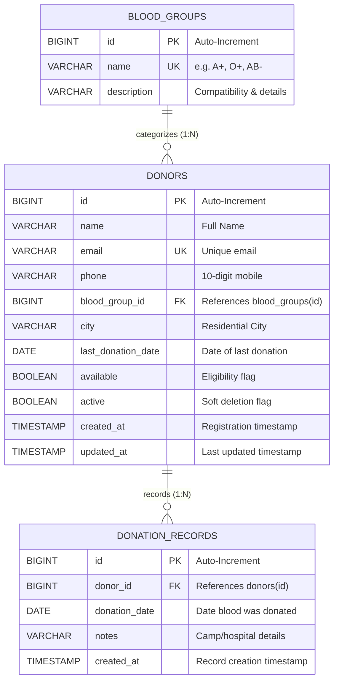

# BloodLink &mdash; Database Documentation

## 1. Database Overview
- **DBMS:** MySQL 8.x
- **Database Name:** `bloodlink_db`
- **Character Set:** `utf8mb4`
- **Collation:** `utf8mb4_unicode_ci`
- **JPA Dialect:** `org.hibernate.dialect.MySQLDialect`
- **DDL Strategy:** `spring.jpa.hibernate.ddl-auto=update`

---

## 2. Entity Relationship Diagram (Mermaid)



---

## 3. Detailed Table Schema Definitions

### Table 1: `blood_groups`
Stores the 8 standard blood group types and medical compatibility notes.

| Column | Data Type | Nullable | Key / Constraint | Description |
|---|---|---|---|---|
| `id` | `BIGINT` | NO | `PRIMARY KEY AUTO_INCREMENT` | Unique Blood Group Identifier |
| `name` | `VARCHAR(10)` | NO | `UNIQUE KEY` | Group Symbol (e.g., `A+`, `O-`, `AB+`) |
| `description` | `VARCHAR(255)`| YES | None | Compatible recipient/donor details |

#### Indexes:
- `idx_blood_group_name` (`name` UNIQUE) &mdash; Accelerates lookups by blood group string.

---

### Table 2: `donors`
Stores registered volunteer donor records, contact information, location, and real-time eligibility flags.

| Column | Data Type | Nullable | Key / Constraint | Description |
|---|---|---|---|---|
| `id` | `BIGINT` | NO | `PRIMARY KEY AUTO_INCREMENT` | Unique Donor Identifier |
| `name` | `VARCHAR(100)`| NO | None | Volunteer's full name |
| `email` | `VARCHAR(150)`| NO | `UNIQUE KEY` | Unique email for communication |
| `phone` | `VARCHAR(20)` | NO | None | 10-digit mobile number |
| `blood_group_id` | `BIGINT` | NO | `FOREIGN KEY -> blood_groups(id)` | Linked Blood Group |
| `city` | `VARCHAR(100)`| NO | None | City/Town (e.g. Coimbatore) |
| `last_donation_date` | `DATE` | YES | None | Date of most recent donation |
| `available` | `BOOLEAN` | NO | `DEFAULT TRUE` | False during 90-day cooldown |
| `active` | `BOOLEAN` | NO | `DEFAULT TRUE` | False if soft-deactivated |
| `created_at` | `TIMESTAMP` | NO | `DEFAULT CURRENT_TIMESTAMP` | Registration audit time |
| `updated_at` | `TIMESTAMP` | NO | `ON UPDATE CURRENT_TIMESTAMP` | Audit modification time |

#### Indexes:
- `idx_donor_email` (`email` UNIQUE) &mdash; Prevents duplicate donor emails and enables $O(1)$ email checks.
- `idx_donor_city` (`city`) &mdash; Speeds up emergency regional donor search queries.
- `idx_donor_blood_group` (`blood_group_id`) &mdash; Accelerates blood-group-based join queries.
- `idx_donor_active_available` (`active`, `available`) &mdash; Composite index filtering eligible donors.
- `idx_donor_last_donation` (`last_donation_date`) &mdash; Optimizes cooldown period evaluations.

---

### Table 3: `donation_records`
Maintains an immutable historical audit log of every blood donation made by registered donors.

| Column | Data Type | Nullable | Key / Constraint | Description |
|---|---|---|---|---|
| `id` | `BIGINT` | NO | `PRIMARY KEY AUTO_INCREMENT` | Unique Donation Record ID |
| `donor_id` | `BIGINT` | NO | `FOREIGN KEY -> donors(id)` | Donor reference |
| `donation_date` | `DATE` | NO | None | Date donation occurred |
| `notes` | `VARCHAR(500)`| YES | None | Camp/Hospital/Event notes |
| `created_at` | `TIMESTAMP` | NO | `DEFAULT CURRENT_TIMESTAMP` | System recording timestamp |

#### Indexes:
- `idx_donation_donor_id` (`donor_id`) &mdash; Speeds up donor donation history queries.
- `idx_donation_date` (`donation_date`) &mdash; Fast ordering for recent donation timelines.

---

## 4. Key Business Logic Queries

### Emergency Search (Active, Available, Outside 90-Day Cooldown)
```sql
SELECT d.id, d.name, bg.name AS blood_group, d.city, d.phone, d.email
FROM donors d
JOIN blood_groups bg ON d.blood_group_id = bg.id
WHERE d.active = TRUE
  AND d.available = TRUE
  AND (d.last_donation_date IS NULL OR d.last_donation_date <= DATE_SUB(CURDATE(), INTERVAL 90 DAY))
  AND (:bloodGroupName IS NULL OR LOWER(bg.name) = LOWER(:bloodGroupName))
  AND (:city IS NULL OR LOWER(d.city) = LOWER(:city));
```

### Total Registered vs Available Donors by Blood Group
```sql
SELECT 
    bg.name AS blood_group,
    COUNT(d.id) AS total_registered,
    SUM(CASE WHEN d.active = TRUE AND d.available = TRUE AND (d.last_donation_date IS NULL OR d.last_donation_date <= DATE_SUB(CURDATE(), INTERVAL 90 DAY)) THEN 1 ELSE 0 END) AS total_available
FROM blood_groups bg
LEFT JOIN donors d ON d.blood_group_id = bg.id AND d.active = TRUE
GROUP BY bg.id, bg.name
ORDER BY bg.id;
```
