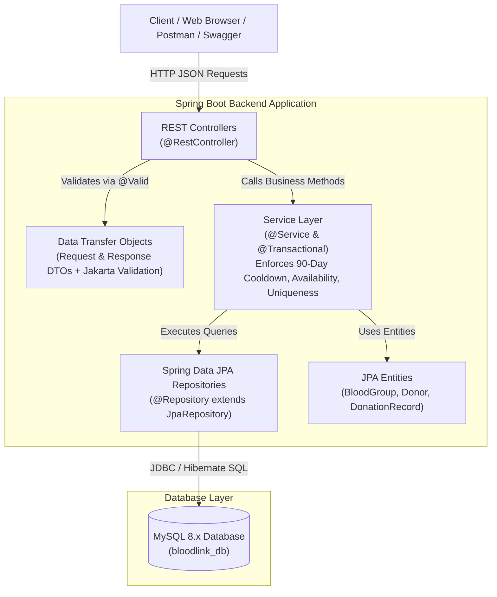
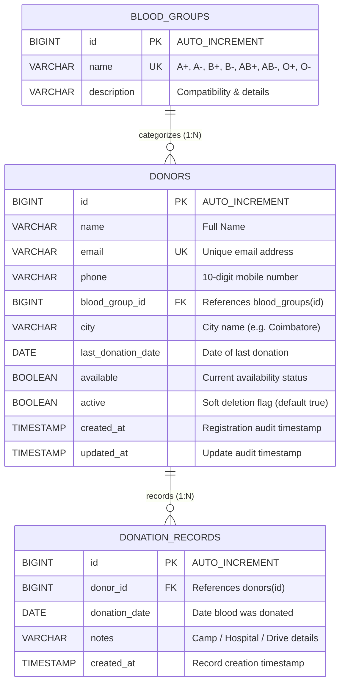

# BloodLink &mdash; Blood Donor Registry and Search System

A complete, production-ready, runnable Java Spring Boot 3.x and MySQL project built for **College Java Programming + DBMS Practical / Project Assessment**.

[](https://openjdk.org/projects/jdk/17/)
[](https://spring.io/projects/spring-boot)
[](https://www.mysql.com/)
[](LICENSE)
[]()

---

## 1. Project Overview & Problem Statement

During emergency medical procedures, trauma cases, or scheduled surgeries, patients' families frequently face acute challenges finding willing blood donors of a matching blood group nearby. Relying on disorganized social media posts or fragmented phone contact lists often causes critical delays.

**BloodLink** solves this challenge by providing a centralized backend registry system that:
- Allows voluntary blood donors to register with their contact details, blood group, and residential city.
- Enables hospitals, clinics, and emergency seekers to instantly search for eligible donors by **blood group** and **city**.
- Enforces a strict, medically grounded **90-day cooldown period** following every blood donation.
- Automatically calculates and restores donor eligibility once the 90-day cooldown expires without requiring manual administrator intervention.
- Maintains comprehensive audit logs of all past blood donations.
- Offers real-time donor availability metrics grouped by blood group.

---

## 2. Technology Stack

- **Backend Framework:** Spring Boot 3.2.5 (Java 17 / Java 21 compatible)
- **Web Layer:** Spring Web MVC, RESTful APIs, Jackson JSON
- **Persistence & ORM:** Spring Data JPA, Hibernate 6.4.x
- **Database:** MySQL 8.x (`bloodlink_db`)
- **Connector:** MySQL Connector/J
- **Input Validation:** Jakarta Bean Validation (Hibernate Validator)
- **API Documentation:** SpringDoc OpenAPI 3.0 & Swagger UI 2.5.0
- **Testing:** JUnit 5, Mockito, Spring Boot Test, MockMvc, H2 (test profile)
- **Frontend:** HTML5, Modern Vanilla CSS (responsive, CSS Grid/Flexbox), Vanilla JavaScript
- **Build & Dependency Management:** Apache Maven 3.9+ / Maven Wrapper

---

## 3. Layered Architecture

BloodLink follows clean software engineering principles with strict layered separation of concerns. Controllers contain **zero business logic**, delegating all validation and domain rules to the Service Layer:



---

## 4. Entity Relationship Diagram (ERD)



---

## 5. Key Business Rules Enforced in Service Layer

| Rule | Description | Implementation |
|---|---|---|
| **Rule 1: 90-Day Cooldown** | A donor cannot donate blood or appear in search results within 90 days of donating. | Calculated dynamically using `LocalDate` and `ChronoUnit.DAYS`. |
| **Rule 2: Update Last Donation Date** | Recording a donation immediately updates `donor.lastDonationDate`. | Handled atomically in `@Transactional DonationRecordServiceImpl`. |
| **Rule 3: Donation Makes Donor Unavailable** | Recording a donation immediately flags `donor.available = false`. | Donor is set to unavailable and persisted during donation logging. |
| **Rule 4 & 5: Auto-Re-enabling Availability** | Once 90 days have elapsed since the last donation date, the donor is automatically recognized as available without admin action. | `checkAndSyncDonorAvailability(donor)` dynamically resets `available = true` and updates the database. |
| **Rule 6: Inactive Exclusion** | Soft-deactivated donors (`active = false`) are permanently excluded from search results. | Search query filters only active and available donors. |
| **Rule 7: Valid Blood Group** | Donor must link to an existing `BloodGroup` row. | Throws `404 NOT_FOUND` if blood group ID does not exist. |
| **Rule 8: Donation Date Validation** | Donation dates cannot be in the future. | Jakarta `@PastOrPresent` and service-layer check. |
| **Rule 9: Non-existent Donor** | Cannot record donation for non-existent donor. | Throws `404 NOT_FOUND` (`ResourceNotFoundException`). |
| **Rule 10: In-Cooldown Donation Rejection** | An existing donor cannot donate again if still in cooldown. | Throws `409 CONFLICT` (`BusinessRuleException`) with next eligible date. |
| **Rule 11: Duplicate Email Prevention** | Each donor email must be globally unique. | Throws `409 CONFLICT` (`DuplicateResourceException`) on registration or update. |

---

## 6. REST API Endpoints Specification

### 🩸 Blood Group APIs (`/api/blood-groups`)
| Method | Endpoint | Description | Status Codes |
|---|---|---|---|
| `POST` | `/api/blood-groups` | Create a new blood group | `201 Created`, `400`, `409` |
| `GET` | `/api/blood-groups` | Retrieve all blood groups with donor counts | `200 OK` |
| `GET` | `/api/blood-groups/{id}` | Get blood group by ID | `200 OK`, `404 Not Found` |
| `PUT` | `/api/blood-groups/{id}` | Update blood group details | `200 OK`, `400`, `404`, `409` |
| `DELETE`| `/api/blood-groups/{id}` | Delete blood group (if no donors attached) | `204 No Content`, `404`, `409` |

### 👥 Donor APIs (`/api/donors`)
| Method | Endpoint | Description | Status Codes |
|---|---|---|---|
| `POST` | `/api/donors` | Register a new volunteer donor | `201 Created`, `400`, `404`, `409` |
| `GET` | `/api/donors` | Get all donors with cooldown indicators | `200 OK` |
| `GET` | `/api/donors/{id}` | Get donor by ID | `200 OK`, `404 Not Found` |
| `PUT` | `/api/donors/{id}` | Update donor details | `200 OK`, `400`, `404`, `409` |
| `DELETE`| `/api/donors/{id}` | Soft-deactivate donor (`active = false`) | `204 No Content`, `404` |
| `GET` | `/api/donors/search` | Search eligible donors by `bloodGroup` & `city` | `200 OK` |
| `GET` | `/api/donors/count-by-blood-group` | Total registered active donors by blood group | `200 OK` |
| `GET` | `/api/donors/available-count-by-blood-group` | Currently available donors by blood group | `200 OK` |
| `GET` | `/api/donors/count-summary` | Full summary (registered vs available counts) | `200 OK` |

### 💉 Donation Record APIs (`/api/donations`)
| Method | Endpoint | Description | Status Codes |
|---|---|---|---|
| `POST` | `/api/donations` | Record a blood donation (triggers 90-day cooldown) | `201 Created`, `400`, `404`, `409` |
| `GET` | `/api/donations` | Get all donation records ordered by date | `200 OK` |
| `GET` | `/api/donations/{id}` | Get donation record by ID | `200 OK`, `404 Not Found` |
| `GET` | `/api/donors/{donorId}/donations` | Get donation history for a specific donor | `200 OK`, `404 Not Found` |

---

## 7. Database Setup & Configuration

### Prerequisites
- MySQL Server 8.0+ running on port `3306`.
- A MySQL user (default: `root`).

### Step 1: Create Database (Manual or Auto)
The application URL includes `createDatabaseIfNotExist=true`, so MySQL will create `bloodlink_db` automatically if permitted.

Alternatively, execute the provided [db_setup.sql](file:///c:/Users/Jaya%20sri/OneDrive/Documents/Bloodlink/db_setup.sql) in MySQL Workbench or the MySQL CLI:
```bash
mysql -u root -p < db_setup.sql
```

### Step 2: Configure Credentials
Edit `src/main/resources/application.properties` to set your local MySQL password:
```properties
spring.datasource.url=jdbc:mysql://localhost:3306/bloodlink_db?createDatabaseIfNotExist=true&useSSL=false&allowPublicKeyRetrieval=true&serverTimezone=UTC
spring.datasource.username=root
spring.datasource.password=YOUR_PASSWORD
```

---

## 8. How to Run the Application

### Option A: Using Maven (Recommended)
Run the application directly using Maven:
```powershell
mvn spring-boot:run
```
*(On Windows PowerShell, if JAVA_HOME is needed: `$env:JAVA_HOME = "C:\Program Files\Java\jdk-21"; mvn spring-boot:run`)*

### Option B: Running the Pre-Packaged Executable JAR
The project builds an all-in-one executable JAR:
```powershell
java -jar target/bloodlink-1.0.0.jar
```

### Option C: Using IntelliJ IDEA or Eclipse
1. Open IntelliJ IDEA &rarr; **File** &rarr; **Open** &rarr; Select the `Bloodlink` folder.
2. Allow IntelliJ to import dependencies from `pom.xml`.
3. Locate `src/main/java/com/bloodlink/BloodLinkApplication.java`.
4. Right-click and choose **Run 'BloodLinkApplication'**.

---

## 9. Accessing the Application

Once started, the application runs on port `8080`:

| Interface | URL |
|---|---|
| **Web Frontend (Emergency Search & Registry UI)** | [http://localhost:8080/](http://localhost:8080/) |
| **Interactive Swagger / OpenAPI UI** | [http://localhost:8080/swagger-ui/index.html](http://localhost:8080/swagger-ui/index.html) |
| **OpenAPI 3.0 JSON Specification** | [http://localhost:8080/api-docs](http://localhost:8080/api-docs) |

---

## 10. Running Automated Tests

The project includes 17 unit and integration tests covering business rules, validation, exception handling, and controller endpoints:

```powershell
mvn test
```

### Test Suite Summary:
- **`DonorServiceTest`**: Tests 90-day cooldown logic, initial availability calculation, duplicate email prevention, invalid blood group rejection, auto-restoration of availability, and search exclusion of cooldown donors.
- **`DonationRecordServiceTest`**: Tests donation logging, status updates to unavailable, rejection of in-cooldown donation attempts, rejection of future dates, and donor 404 validation.
- **`DonorControllerTest`**: WebMvcTest testing REST request validation (Bean Validation field errors), search filtering endpoints, and donor metrics.
- **`BloodLinkApplicationTests`**: Spring context bootstrapping test.

---

## 11. Testing with Postman

1. Open Postman.
2. Click **Import** &rarr; select `BloodLink_API.postman_collection.json`.
3. Click **Import** &rarr; select `BloodLink_Environment.postman_environment.json`.
4. Set the active environment to **BloodLink Local Environment** (which points `{{base_url}}` to `http://localhost:8080`).
5. Execute requests across the 5 categorized folders:
   - *Blood Groups*
   - *Donors*
   - *Donor Search (90-Day Cooldown Enforced)*
   - *Donor Counts & Inventory*
   - *Donations*

---

## 12. Project Structure

```
Bloodlink/
  ├── pom.xml                                   # Maven dependencies & build configuration
  ├── db_setup.sql                              # Pure MySQL DDL & DML script
  ├── DATABASE.md                               # Comprehensive database documentation & ERD
  ├── README.md                                 # Complete project documentation
  ├── BloodLink_API.postman_collection.json     # Postman API Collection
  ├── BloodLink_Environment.postman_environment.json # Postman Environment
  ├── .mvn/wrapper/                             # Maven wrapper configuration
  ├── src/
      ├── main/
      │   ├── java/com/bloodlink/
      │   │   ├── BloodLinkApplication.java     # Main Spring Boot application entry point
      │   │   ├── config/
      │   │   │   ├── OpenApiConfig.java        # Swagger OpenAPI 3.0 configuration
      │   │   │   └── DataInitializer.java     # CommandLineRunner demo data seeder
      │   │   ├── controller/
      │   │   │   ├── BloodGroupController.java # Blood Group REST APIs
      │   │   │   ├── DonorController.java      # Donor CRUD, Search & Counts APIs
      │   │   │   └── DonationRecordController.java # Donation Logging APIs
      │   │   ├── dto/
      │   │   │   ├── request/
      │   │   │   │   ├── CreateBloodGroupRequest.java
      │   │   │   │   ├── UpdateBloodGroupRequest.java
      │   │   │   │   ├── CreateDonorRequest.java
      │   │   │   │   ├── UpdateDonorRequest.java
      │   │   │   │   └── CreateDonationRequest.java
      │   │   │   └── response/
      │   │   │       ├── BloodGroupResponse.java
      │   │   │       ├── DonorResponse.java
      │   │   │       ├── DonationRecordResponse.java
      │   │   │       ├── BloodGroupCountResponse.java
      │   │   │       ├── ErrorResponse.java
      │   │   │       └── ValidationErrorResponse.java
      │   │   ├── entity/
      │   │   │   ├── BloodGroup.java           # Blood group JPA entity
      │   │   │   ├── Donor.java                # Donor JPA entity with audit timestamps
      │   │   │   └── DonationRecord.java       # Donation record JPA entity
      │   │   ├── exception/
      │   │   │   ├── ResourceNotFoundException.java # 404 handler
      │   │   │   ├── BusinessRuleException.java     # 409 rule violation handler
      │   │   │   ├── DuplicateResourceException.java # 409 conflict handler
      │   │   │   └── GlobalExceptionHandler.java    # @RestControllerAdvice
      │   │   ├── repository/
      │   │   │   ├── BloodGroupRepository.java
      │   │   │   ├── DonorRepository.java
      │   │   │   └── DonationRecordRepository.java
      │   │   └── service/
      │   │       ├── BloodGroupService.java
      │   │       ├── DonorService.java
      │   │       ├── DonationRecordService.java
      │   │       └── impl/
      │   │           ├── BloodGroupServiceImpl.java
      │   │           ├── DonorServiceImpl.java
      │   │           └── DonationRecordServiceImpl.java
      │   └── resources/
      │       ├── application.properties        # Main MySQL configuration
      │       ├── application-example.properties# Template configuration
      │       └── static/
      │           ├── index.html                # Frontend Single Page Application
      │           ├── css/styles.css            # Modern responsive CSS styling
      │           └── js/app.js                 # Frontend application logic & API client
      └── test/
          ├── java/com/bloodlink/
          │   ├── BloodLinkApplicationTests.java
          │   ├── service/
          │   │   ├── DonorServiceTest.java
          │   │   └── DonationRecordServiceTest.java
          │   └── controller/
          │       └── DonorControllerTest.java
          └── resources/
              └── application-test.properties   # H2 in-memory test configuration
```

---

## 13. Author & Assessment Information
- **Project Title:** BloodLink &mdash; Blood Donor Registry and Search
- **Subject:** Java Programming &amp; Database Management Systems (DBMS)
- **Target Platform:** Java 17+ / Spring Boot 3.x / MySQL 8.x
